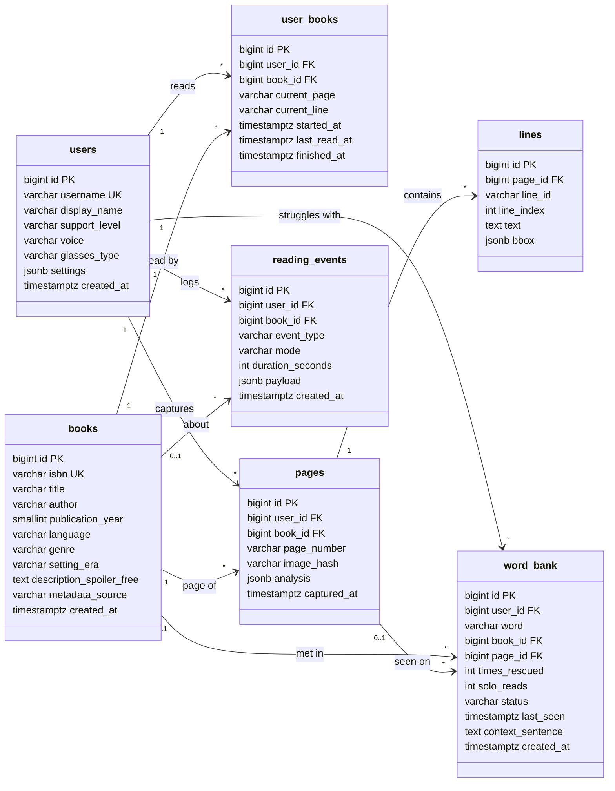

# Database schema (PostgreSQL)

What exists today: migrations `0001` and `0002`, applied to the Aiven PostgreSQL database
(PostgreSQL 18). Checked against the live database on 2026-11-14: every table, column, unique
key and foreign key below matches, and all seven tables are still empty.
Source of truth for the code: `apps/api/app/db/models.py`. Product rules: SOP sections 5 and 10.
GitHub renders the diagram below; to change the schema, add a new Alembic migration (never edit
tables by hand) and update this file.

Legend: PK primary key, FK foreign key, UK unique. `timestamptz` = timestamp with time zone.

## What each field is for

### `users`: the reader and their preferences
No password, email or other contact details (SOP section 10). A reader signs in with a username
only; every other table links to `users.id`. HACK: anyone who types a username sees that
reader's progress; add a device token or PIN before real users.

| Field | Purpose in the app |
|---|---|
| `id` | Internal reader id; every other table points back to it. |
| `username` | How the reader signs in (no password). Unique, stored lowercase, 3-32 characters of a-z, 0-9, `_`, `.`, `-`; "Mick" and "mick" are the same reader. A new username creates a new reader. |
| `display_name` | Friendlier name the app uses to greet the reader. Optional; falls back to the username. |
| `support_level` | How much help the reader wants: `listen` (app reads aloud), `read_along` (default; synced highlight, help on request) or `solo` (reader leads, minimal help). Drives fading support and the "independence" metric. |
| `voice` | TTS voice picked at setup for read-aloud and word pronunciation. |
| `glasses_type` | `display` (Ray-Ban Display: highlight on the lens) or `gen2` (Ray-Ban Meta Gen 2: audio-only mode). |
| `settings` | Extra preferences, mainly letter, word and line spacing for the on-glasses text. |
| `created_at` | When the account was made. |

### `books`: shared library, metadata only
Never holds book text. Gives the brain context ("Tory" in a 19th-century novel vs a news article).

| Field | Purpose in the app |
|---|---|
| `id` | Internal book id. |
| `isbn` | Unique; lets `/books/identify` find a cached record from a barcode instead of looking it up again. |
| `title`, `author` | Read back to the user to confirm the book; added to every brain prompt. |
| `publication_year` | Era context for word meanings and answers. |
| `language` | Which language to analyse and speak (BCP 47, e.g. `en-GB`). |
| `genre` | Context for answers and illustrations. |
| `setting_era` | Where and when the story is set, e.g. "19th-century England"; shapes definitions and illustration style. |
| `description_spoiler_free` | Short background blurb for context. Must never reveal plot. |
| `metadata_source` | Where the metadata came from (e.g. a public book API or the cover read), so bad records can be traced. |
| `created_at` | When the book entered the library. |

### `user_books`: where each reader is in each book

| Field | Purpose in the app |
|---|---|
| `id` | Internal id. |
| `user_id`, `book_id` | Which reader and which book (one row per pair). |
| `current_page`, `current_line` | Saved position, so "continue reading" resumes at the right page and line. |
| `started_at` | When the reader first opened the book. |
| `last_read_at` | Last session; used to offer the most recent book. |
| `finished_at` | Set when the book is done. Should trigger deletion of that reader's captured pages and lines (privacy rule). TODO(Mick Ola): not automated yet; no code sets it or deletes the pages. |

### `pages`: pages the reader has photographed
Derived data only: the photo itself is never stored.

| Field | Purpose in the app |
|---|---|
| `id` | Internal id. |
| `user_id`, `book_id` | Whose capture, from which book. |
| `page_number` | Printed page label (text, because books use roman numerals); helps resume and cite. |
| `image_hash` | SHA-256 fingerprint of the photo. A repeat photo of the same page is served from cache with no new Nemotron call. Cannot be turned back into the image. |
| `analysis` | The validated page JSON from Nemotron (SOP 8.1): reading order, phrase chunks, hard words with syllables and meanings, conversation plan. |
| `captured_at` | When the page was captured. |

### `lines`: captured line text, for grounding answers
Belongs to one reader; deleted when the book is finished or on request.

| Field | Purpose in the app |
|---|---|
| `id` | Internal id. |
| `page_id` | Which captured page the line is on. Deleting the page deletes its lines. |
| `line_id` | The id from the page JSON (e.g. `L2`, `caption_1`); answers cite these. |
| `line_index` | Position in reading order, so answers and context come out in the right order. |
| `text` | The words on the line. Only used to ground this reader's answers ("answers only from pages read", no spoilers). |
| `bbox` | Where the line sits in the photo; used to match the reader's fingertip to the nearest line. |

### `word_bank`: words the reader struggled with
One row per reader per word. Survives when captured pages are deleted.

| Field | Purpose in the app |
|---|---|
| `id` | Internal id. |
| `user_id` | Whose word bank. |
| `word` | The word itself. |
| `book_id`, `page_id` | Where the word was last met, for context. Optional, so the entry survives page deletion. |
| `times_rescued` | How often the reader needed help with it; drives which words get flagged on new pages. |
| `solo_reads` | How often they then read it without help; evidence they are learning it. |
| `status` | `learning` or `owned` (the reader now reads it on their own). The rule for switching is still open. |
| `last_seen` | When they last met the word. |
| `context_sentence` | The sentence where they met it, for revisiting the word in context. |
| `created_at` | When it first went into the word bank. |

### `reading_events`: append-only activity log
Progress is computed from this: minutes read per week, pages finished, words rescued per page,
independence (share of reading in `solo`). Rows are never edited.

| Field | Purpose in the app |
|---|---|
| `id` | Internal id. |
| `user_id` | Whose activity. |
| `book_id` | Which book, if any. |
| `event_type` | What happened: `page_read`, `word_rescued`, `question_asked`, `mode_changed`. |
| `mode` | Support level at the time; powers the independence metric. |
| `duration_seconds` | Time spent, mainly on `page_read`; powers minutes read per week. |
| `payload` | Small extra details (e.g. which word, old and new mode). Never images, audio or Everyday-mode documents. |
| `created_at` | When it happened; progress is grouped by this. |

## Rules the schema enforces

- `books` has no text column: book text is never stored in the shared library.
- No column stores images or audio (checked by `apps/api/app/tests/test_models.py`).
- Usernames are unique and stored lowercase (`uq_users_username`), so one name is one reader.
- One row per reader per book (`user_books`), per reader per word (`word_bank`), per line per
  page (`lines`), and per reader, book and photo (`pages`, via `image_hash`).
- What a delete takes with it:

| Deleted | Also deleted | Kept, link emptied |
|---|---|---|
| a user | their `user_books`, `pages` (and so `lines`), `word_bank`, `reading_events` | nothing |
| a book | every reader's `user_books` and `pages` for it (and so `lines`) | `word_bank.book_id`, `reading_events.book_id` |
| a page | its `lines` | `word_bank.page_id` |

## What writes each table today

| Table | Written by | Status |
|---|---|---|
| `users` | `db/repositories/users.py` `get_or_create_user(username)` | Code ready; no endpoint yet (agree `POST /users` with Alex) |
| `books` | `POST /books/identify` via `db/repositories/books.py` | Live |
| `user_books`, `pages`, `lines`, `word_bank`, `reading_events` | Nothing yet | Waiting on `POST /page`, the brain's `BrainStore` and `/progress` |

## How the brain's types map onto these tables

Matthew's `brain/core` reads and writes through `BrainStore` (`brain/tools/store.py`). Mick
implements it on these tables; the store translates the few fields that differ.

| Brain type / call | Tables | Difference to handle in the store |
|---|---|---|
| `BookContext` | `books` | Same fields (minus `isbn`, `metadata_source`) |
| `ReaderProfile` | `users.support_level`, `word_bank.status` | `struggled_words` = `learning`, `owned_words` = `owned` |
| `CapturedPage` | `pages` + `lines` | Brain `page_id` is text (`"p12"`), ours is a number; brain `page_number` is a number, ours is text (roman numerals) |
| `add_to_word_bank(...)` | `word_bank` | Brain passes `page_id` as text; bump `times_rescued` on a repeat |
| `PageAnalysis` (SOP 8.1) | `pages.analysis` | Stored whole as JSONB; bbox is `[x, y, w, h]` from 0 to 1 |
